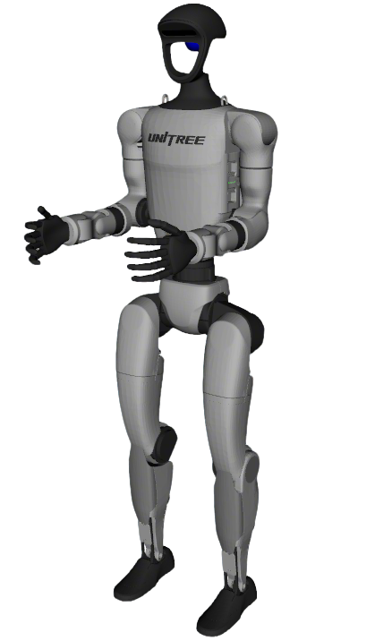

# Unitree Robot Descriptions

Unitree humanoid and wheeled dual-arm descriptions. Legged G1 keeps shared arm, head, and end-effector macros that G1-D reuses. R1-D has its own arm and torso and only reuses the G1 hand macros.

| | | |
|:---:|:---:|:---:|
|  | | |
| **[G1](unitree_g1_description/)** (legged) | **G1-D** (`unitree_g1d_description`) | **R1-D** (`unitree_r1d_description`) |

Quadrupeds (Go1, Go2, A1, B2, Aliengo) live in [robot-descriptions-quadruped](https://github.com/fiveages-sim/robot-descriptions-quadruped).

## Shared macros (`unitree_g1_description`)

| Macro / file | Reused by |
|--------------|-----------|
| `xacro/arm.xacro` (`UnitreeG1Arm`) | G1, G1-D |
| `xacro/head.xacro` (`UnitreeG1Head`) | G1, G1-D (mount offset differs) |
| `xacro/hand.xacro` (`type`: `rubber_hand` / `revo2` / `dex3` / `none`) | G1, G1-D, R1-D |

## Common Commands

```bash
cd ~/ros2_ws
colcon build --packages-up-to unitree_g1_description unitree_g1d_description unitree_r1d_description --symlink-install
source ~/ros2_ws/install/setup.bash
```

```bash
# Legged G1 (rubber hand default)
ros2 launch robot_common_launch humanoid.launch.py robot:=unitree_g1

# G1 with Dex3
ros2 launch robot_common_launch humanoid.launch.py robot:=unitree_g1 type:=dex3

# Wheeled G1-D (Dex3 default)
ros2 launch robot_common_launch manipulator.launch.py robot:=unitree_g1d

# Wheeled R1-D (no end effector by default)
ros2 launch robot_common_launch manipulator.launch.py robot:=unitree_r1d
ros2 launch robot_common_launch manipulator.launch.py robot:=unitree_r1d type:=dex3
```

These packages are licensed under [Apache-2.0](LICENSE). Upstream model sources are listed in [NOTICE](NOTICE).
